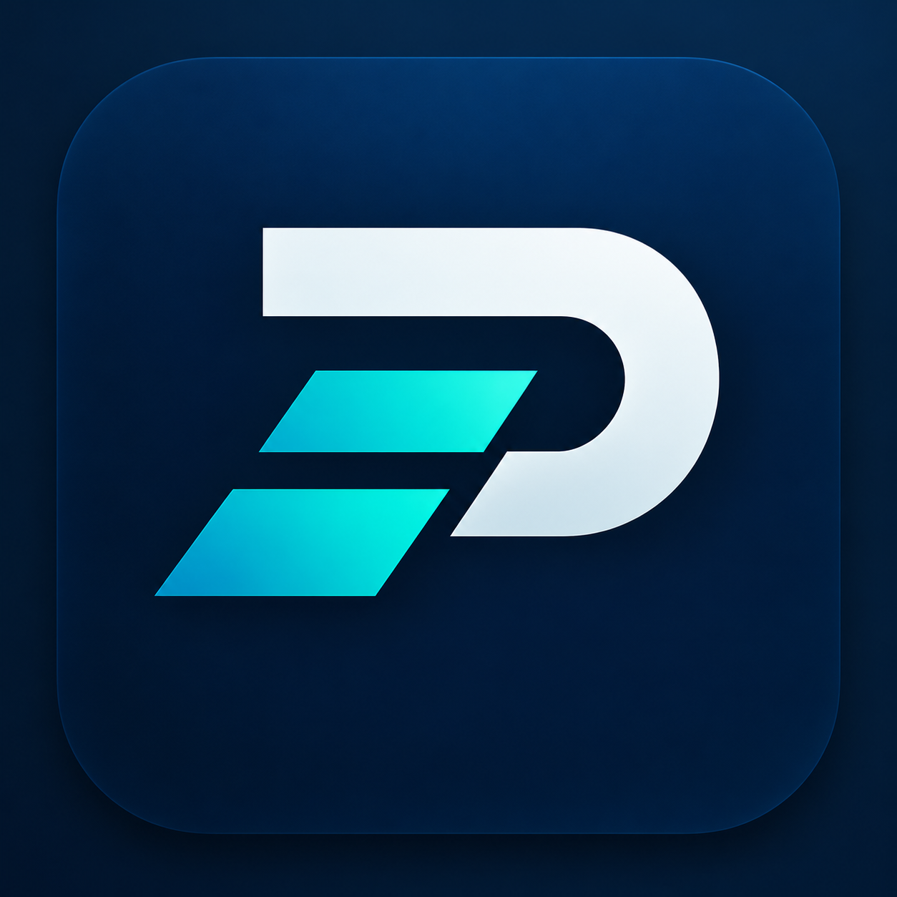
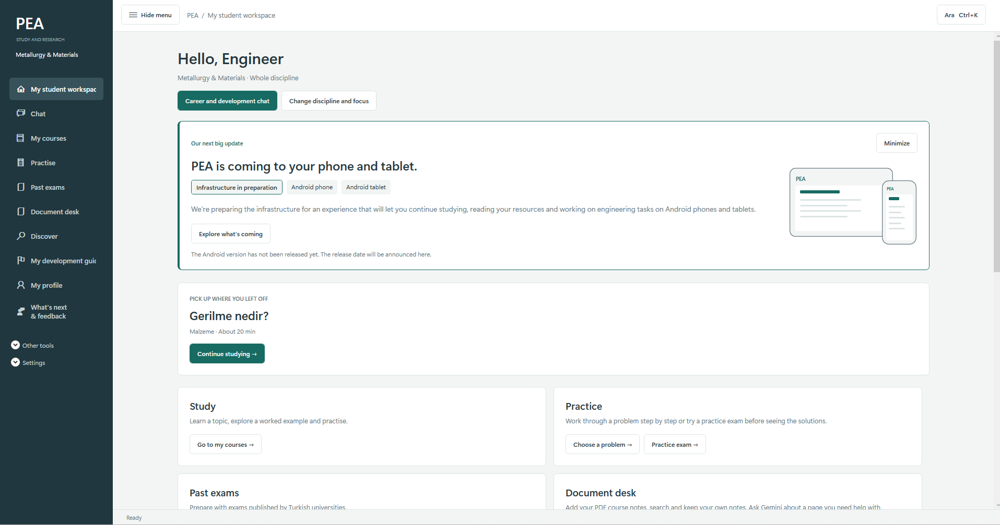
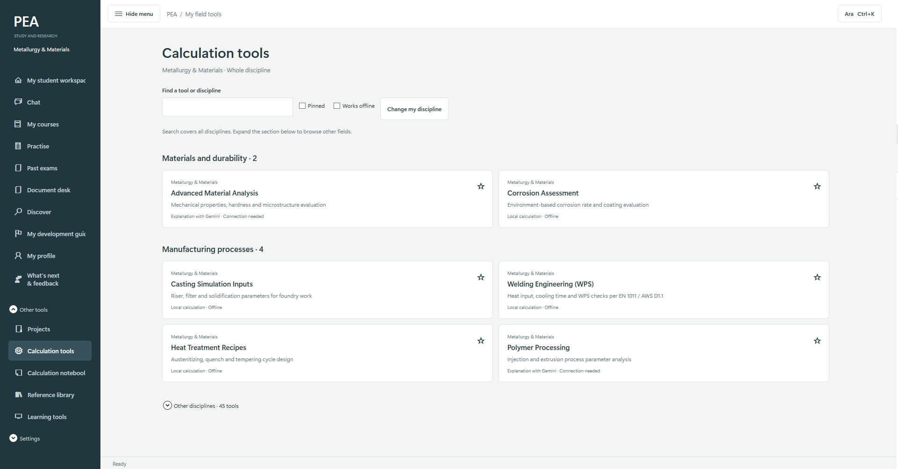
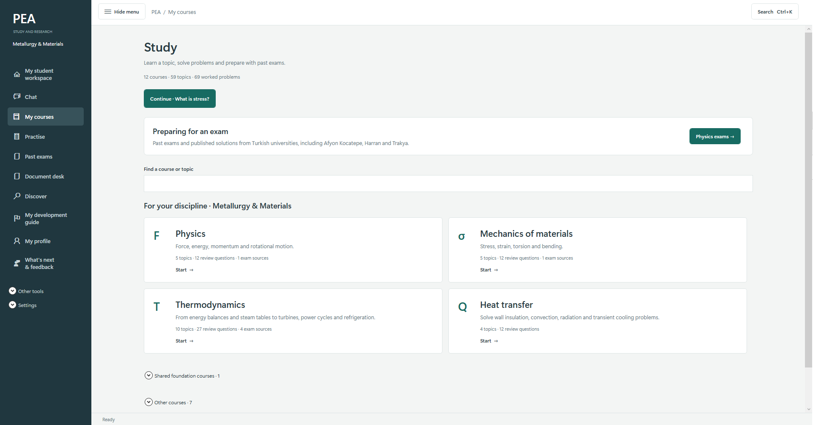
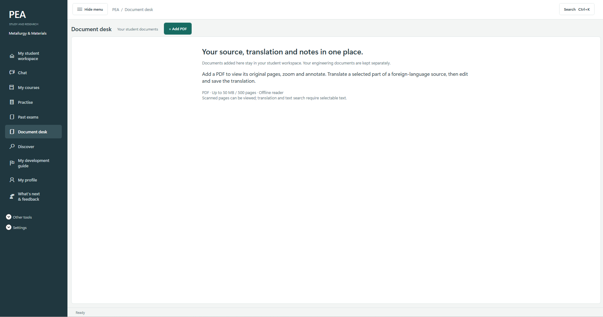

 

# Pro Engineer Assistant

### Your Engineering & Study Workspace

**Learn. Calculate. Explore. Build.**

A modern Windows workspace bringing engineering tools, educational resources, project organization, and AI-assisted workflows together.

**Windows: Available** · **Android: Planned**

---

## Welcome to PEA

**Pro Engineer Assistant (PEA)** is an independent Windows desktop application designed to make engineering and technical education more accessible, practical, and organized.

Instead of constantly switching between calculation software, reference materials, course resources, and project files, PEA brings them into one focused workspace.

Originally inspired by **Metallurgy & Materials Engineering**, PEA is being developed with a broader engineering vision.

Whether you're studying for an exam, exploring technical concepts, or working on an engineering project, PEA aims to simplify your workflow.

---

## Application Preview

*The PEA workspace — your starting point for study and engineering work.*

---

## Explore the Features

| Feature | Description |
|---|---|
| **Engineering Calculations** | Practical tools for engineering problems across multiple disciplines |
| **Student Workspace** | A focused environment for learning, organizing, and continuing your work |
| **Courses & Practice** | Study engineering topics, explore worked problems, and prepare for examinations |
| **Document Desk** | Read PDF documents, organize notes, and work with technical resources |
| **AI Assistance** | Optional AI-powered explanations and support for selected tasks |
| **Reference Resources** | Access materials, formulas, and other engineering information |
| **Project Organization** | Manage technical workflows, calculations, and project-related information |
| **Development Guidance** | Explore learning paths and personal development resources |

---

## Inside PEA

### 01 — Engineering Calculation Tools

Access technical calculation utilities through a structured, discipline-oriented interface.

Tools include applications related to:

- Materials analysis and durability
- Corrosion assessment
- Casting and manufacturing
- Welding engineering
- Heat treatment
- Other engineering disciplines

*Engineering tools organized by discipline and application.*

### 02 — Study & Learning

PEA is not limited to professional engineering work.

It also provides a dedicated learning environment for engineering students.

Explore subjects, review technical concepts, solve problems, and prepare for exams.

Study areas include:

- Physics
- Mechanics of Materials
- Thermodynamics
- Heat Transfer
- Additional engineering subjects

*Structured engineering education, all in one place.*

### 03 — Document Desk

Engineering often requires working with textbooks, technical papers, and reference documents.

PEA includes a document workspace designed to help students and engineers organize their reading and notes.

Supported workflows include PDF reading, selected-text translation, annotations, and document organization.

*Your documents, translations, and notes in one workspace.*

---

## Official Trailer

Discover the visual concept behind Pro Engineer Assistant.

### [▶ Watch / Download the Official Trailer](assets/pea-trailer.mp4)

*30-second product trailer*

---

## Why Pro Engineer Assistant?

**One workspace. Multiple possibilities.**

PEA focuses on combining practical engineering utilities with educational support.

<b>Engineering productivity — Click to explore</b>

### Built for focused technical work

PEA helps users:

- Access tools without switching between multiple applications
- Organize technical information
- Work with engineering calculations
- Maintain a more structured workflow
- Access reference materials when needed

<b>Student experience — Click to explore</b>

### Designed with students in mind

PEA provides an environment for:

- Studying engineering topics
- Reviewing course concepts
- Practicing technical problems
- Preparing for exams
- Reading and annotating documents
- Exploring engineering career paths

<b>AI-assisted workflows — Click to explore</b>

### Additional support when you need it

Selected PEA features integrate AI-assisted explanations to help users explore technical topics.

Some AI features require an internet connection and API configuration.

AI-generated information should be verified before being used in safety-critical or professional engineering decisions.

<b>What makes PEA different? — Click to explore</b>

PEA is being built around a simple idea:

**Engineering productivity and engineering education should work together.**

The project combines calculation tools, study resources, documents, and organization within a consistent interface.

PEA is developed independently and continues to evolve through research, experimentation, and user feedback.

---

## Technology

PEA is developed using technologies that support Windows desktop workflows and engineering-oriented applications.

| Category | Technology |
|---|---|
| Primary language | C# |
| Platform | Windows Desktop |
| AI integration | Google Gemini API |
| Distribution | Microsoft Store |
| Application focus | Engineering & Education |

**Source Code:** The application's source code is not currently public.

This repository is the public project information, documentation, and update hub for PEA.

---

## Development Roadmap

PEA is an actively developed project.

- [x] Windows desktop application
- [x] Microsoft Store release
- [x] Engineering calculation tools
- [x] Student learning workspace
- [x] Course and practice resources
- [x] Document workspace
- [x] AI-assisted features
- [ ] Additional engineering modules
- [ ] Expanded laboratory and learning experiences
- [ ] Continued performance and stability improvements
- [ ] Android phone support
- [ ] Android tablet support

*Roadmap items represent development plans and may change.*

---

## PEA on Android — Planned

PEA is preparing for a future mobile experience.

The long-term vision is to make selected engineering and educational workflows accessible on Android phones and tablets.

Potential mobile use cases include:

- Studying engineering topics
- Accessing reference resources
- Performing calculations
- Reviewing educational content
- Working across different devices

**The Android version has not been released yet.**

A release date will be announced when development is ready.

---

## Frequently Asked Questions

<b>Is PEA available now?</b>

Yes. The Windows version of Pro Engineer Assistant is available through Microsoft Store. Availability and pricing may vary by region.

[View on Microsoft Store](https://apps.microsoft.com/detail/9NDN8V63VXZL)

<b>Is PEA only for metallurgy students?</b>

No. Although PEA was originally inspired by Metallurgy & Materials Engineering, the project includes tools and resources designed for a broader engineering audience.

<b>Does PEA require an internet connection?</b>

Selected calculation tools and learning resources can work offline.

AI-assisted features and certain online resources require an internet connection.

<b>Is PEA open source?</b>

Not currently.

This repository provides public documentation, product information, and project updates.

The source code of the application is not currently published.

<b>Will there be an Android version?</b>

Android support is planned for future development.

The mobile version is not currently available, and no official release date has been announced.

---

## Feedback & Suggestions

PEA is independently developed, and user feedback is valuable for its continued improvement.

Found a bug? Have an idea? Want to suggest a feature?

You can share your feedback through GitHub Issues.

---

## Support the Project

If you find PEA useful, you can support its development by:

- Trying the application
- Sharing feedback
- Reporting issues
- Recommending PEA to other students or engineers
- Starring this repository

Every suggestion helps shape future development.

---

### Pro Engineer Assistant

**Engineering Tools. Education. One Workspace.**

A practical engineering workspace, independently developed and continuously improved.

**Made for engineers. Built with curiosity.**

